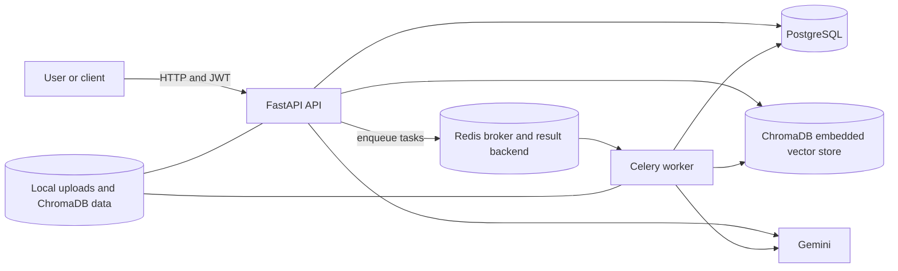

# DocuMind

DocuMind is a multi-tenant Retrieval-Augmented Generation (RAG) and AI task-automation platform. It gives each authenticated user a private document workspace, answers questions using retrieved document passages with citations, and runs bounded tool-using agent workflows.

## Overview

Users can:

- Register and authenticate with JWT access and refresh tokens.
- Upload PDF, TXT, and Markdown documents.
- Process uploads asynchronously with Celery and Redis.
- Search their documents using Sentence Transformers embeddings and ChromaDB.
- Ask grounded questions with citations to retrieved chunks.
- Continue multi-turn conversations with stored message history.
- Run bounded AI agent workflows with a visible tool-call trace.
- Evaluate assistant answer groundedness against cited document chunks.

The API and services are organized as a backend project; API consumers can use Swagger, ReDoc, or the included Postman collection.

## Problem

An LLM does not automatically have access to a user's private documents. When it answers without relevant evidence, it may produce unsupported details. Parsing and embedding long documents can take too long to perform during an API request, and a multi-user service must prevent one user's documents and results from leaking to another user.

DocuMind addresses these problems with document retrieval, citations, background ingestion, and user-scoped data access. Its evaluation workflow also checks whether an answer is supported by the chunks it cites.

## Key Features

### Implemented

- JWT registration, login, refresh, and authenticated profile routes.
- PDF, TXT, and Markdown upload with asynchronous ingestion and status polling.
- Text extraction, chunking, local Sentence Transformers embeddings, and persistent ChromaDB storage.
- User-scoped semantic retrieval and Gemini-powered RAG responses with chunk citations.
- Stored conversations and message history for multi-turn chat.
- Bounded Gemini tool calling with a returned execution trace.
- Three agent tools: knowledge-base search, whitelisted structured metadata queries, and Markdown report generation.
- Asynchronous groundedness evaluation using Gemini as judge when configured, with a lexical fallback.
- Pytest unit and API integration suites, plus an importable Postman collection and development environment.

### Planned or incomplete

- Phase 6 containerization, CI/CD, and deployment are not implemented in this repository.
- URL ingestion is described in the design documents but is not implemented.
- A hosted demo video has not been added; the link below is a placeholder.
- Production operations such as horizontal scaling and managed file/vector storage are not implemented.

## Architecture



- **FastAPI** handles HTTP routes, request validation, authentication dependencies, and API responses.
- **PostgreSQL** stores users, documents, chunk text and metadata, conversations, messages, tasks, and evaluation results through SQLAlchemy.
- **ChromaDB** stores document embeddings and supports semantic similarity search. It is used as a persistent embedded store.
- **Redis** is the Celery message broker and result backend.
- **Celery** runs document ingestion and groundedness evaluation outside the request/response path.
- **Gemini** generates RAG answers, selects agent tools, and can judge groundedness.
- **Local storage** holds uploaded files and the persisted ChromaDB database, in directories configured by `UPLOAD_DIR` and `CHROMA_PERSIST_DIR`.

## End-to-End Workflow

### Document ingestion

```text
Upload file
-> Create document record
-> Create task record
-> Enqueue Celery task
-> Parse file
-> Chunk text
-> Generate embeddings
-> Store vectors in ChromaDB
-> Store chunk metadata and text in PostgreSQL
-> Mark document as ready
```

The upload route returns while ingestion is pending. The client can poll the document status route; processing failures mark the document failed and store an error message.

### RAG chat

```text
User question
-> Generate query embedding
-> Retrieve user-scoped chunks
-> Build grounded prompt
-> Call Gemini
-> Parse citations
-> Store conversation and messages
-> Return answer
```

A question can continue an existing conversation. If retrieval returns no chunks, the current service returns an explicit no-context response without calling Gemini.

### Agent workflow

The agent runs a bounded tool-calling loop. Each requested tool is dispatched by the application, receives the authenticated user's ID, and returns its result to Gemini. The response includes the final answer and tool-call trace.

```text
Task
-> LLM selects a tool
-> Application validates and executes the tool
-> Tool result goes back to the LLM
-> LLM may call another tool
-> Final answer and tool trace are returned
```

Available tools:

- **Knowledge-base search** retrieves semantically relevant passages from the current user's documents.
- **Structured data query** runs a small set of whitelisted, parameterized SQLAlchemy metadata queries, such as document counts and recent documents. It does not execute model-supplied arbitrary SQL.
- **Report generation** formats supplied findings into a Markdown report.

The API accepts a maximum of 10 tool steps per request (default 5).

### Evaluation workflow

```text
Assistant message
-> Validate cited chunk IDs
-> Load cited chunk text
-> Compare answer with context
-> Use LLM-as-judge or lexical fallback
-> Store groundedness score and flagged status
```

Evaluation is asynchronous. It rejects unknown or non-user-owned cited chunks. If Gemini is unavailable or unconfigured, it uses a lexical overlap heuristic. This is a lightweight signal, not a guarantee of factual correctness.

## Security and Multi-Tenancy

- Passwords are hashed with bcrypt.
- JWT access and refresh tokens are signed with separate secrets and have configurable expiry periods.
- Protected routes obtain the user from the validated access token.
- Document, vector retrieval, conversation, task, and evaluation queries are scoped to the authenticated user; vector queries include a user metadata filter.
- The structured data tool uses a fixed allowlist of parameterized SQLAlchemy queries.
- Application secrets and service URLs are configured through environment variables. Copy `.env.example` to `.env`, set local values, and never commit `.env` or real credentials. `.env` is ignored by Git.

Current limitations to address before production use:

- Uploaded files and ChromaDB data are stored on local disk. This needs persistent shared storage for multi-instance deployments, backups, or reliable horizontal scaling.
- The upload path uses the client-provided filename without explicit filename sanitization. Treat uploads as a local-development feature until this is fixed and reviewed.
- The 50 MB upload limit is checked after writing the file to disk, and validation is based on the filename extension rather than file content.
- The health route reports API liveness and configuration values; it does not check PostgreSQL, Redis, ChromaDB, or Gemini readiness.
- CORS allows all origins in development mode. Configure a restrictive origin list before exposing a development environment.
- There is no distributed rate limiting or horizontal scaling configuration in the repository.

## Technology Stack

| Area | Technology |
|---|---|
| API | FastAPI |
| Database | PostgreSQL with SQLAlchemy |
| Migrations | Alembic |
| Authentication | JWT and bcrypt |
| Vector store | ChromaDB |
| Embeddings | Sentence Transformers (`all-MiniLM-L6-v2` by default) |
| LLM | Google Gemini (`google-genai`) |
| Background tasks | Celery |
| Broker/result backend | Redis |
| Testing | Pytest |
| API testing | Postman |

## Project Structure

- `app/api/` — versioned FastAPI routers and endpoints.
- `app/core/` — password/token security and authenticated-user dependencies.
- `app/db/` — SQLAlchemy session/base and Alembic migrations.
- `app/models/` — database models for users, documents, chunks, conversations, messages, tasks, and evaluations.
- `app/schemas/` — Pydantic request and response models.
- `app/services/` — ingestion, chunking, embeddings, vector storage, retrieval, LLM, agent, and evaluation logic.
- `app/tools/` — knowledge search, structured metadata query, and report tools for the agent.
- `app/workers/` — Celery application and asynchronous tasks.
- `tests/` — unit and API integration tests.
- `postman/` — API collection and development/placeholder environments.

## Local Setup

The following commands are for Windows PowerShell from the repository directory. Configure a PostgreSQL database, Redis service, and Gemini API key first. The supplied `.env.example` contains development defaults for local PostgreSQL and Redis; edit your `.env` values to match the services you run.

```powershell
cd "<path-to-your-cloned-repository>"
if (-not (Test-Path .env)) { Copy-Item .env.example .env }
# Edit .env and set secrets and connection settings for your environment.
if (-not (Test-Path .venv)) { python -m venv .venv }
.\.venv\Scripts\Activate.ps1
python -m pip install -r requirements.txt
python -m alembic upgrade head
```

The repository's local `.venv` may not exist in a fresh checkout. Create it with `python -m venv .venv` before activating it if needed. Keep `.env` local and do not paste real credentials into documentation or source control.

## Running the API

```powershell
python -m uvicorn app.main:app --reload --host 127.0.0.1 --port 8000
```

- Swagger UI: <http://127.0.0.1:8000/docs>
- ReDoc: <http://127.0.0.1:8000/redoc>
- Health endpoint: <http://127.0.0.1:8000/api/v1/health>

## Running the Celery Worker

Start Redis, then run this command in a separate PowerShell terminal with the virtual environment activated:

```powershell
celery -A app.workers.celery_app.celery_app worker --loglevel=info --pool=solo
```

The API accepts requests and enqueues work; the worker consumes tasks from Redis and performs ingestion and evaluations. They run as separate processes, so both terminals must remain open during local use.

## Demo Flow

Import `postman/DocuMind.postman_collection.json` and `postman/DocuMind_Dev.postman_environment.json` into Postman, start the API and worker, and select the development environment. The collection stores tokens and several resource IDs in environment variables as requests run.

1. Register a user, or log in with an existing user.
2. Upload a PDF, TXT, or Markdown file.
3. Poll document status until it is `ready`.
4. Ask a question whose answer appears in the uploaded document.
5. Inspect the returned answer and citations.
6. Run an agent task that combines document search and a structured metadata query, for example: “Find the main topic in my documents, check how many documents I have, and summarize both findings.”
7. Inspect the agent response's tool-call trace.
8. Submit the assistant message ID to the asynchronous evaluation endpoint and poll the returned task.
9. Retrieve the evaluation result, then evaluate a second assistant message containing an unsupported claim to demonstrate a flagged result.
10. Compare the grounded and flagged scores and notes.

## API Overview

All routes are under `/api/v1`. Protected routes require `Authorization: Bearer <access_token>`.

| Method | Path | Purpose |
|---|---|---|
| POST | `/api/v1/auth/register` | Register a user and return access/refresh tokens |
| POST | `/api/v1/auth/login` | Authenticate and return access/refresh tokens |
| POST | `/api/v1/auth/refresh` | Exchange a refresh token for a new token pair |
| GET | `/api/v1/auth/me` | Get the authenticated user's profile |
| POST | `/api/v1/documents/upload` | Upload a supported file and enqueue ingestion |
| GET | `/api/v1/documents/` | List the current user's documents |
| GET | `/api/v1/documents/{document_id}/status` | Poll document ingestion status |
| DELETE | `/api/v1/documents/{document_id}` | Delete a document, chunks, vectors, and local file |
| POST | `/api/v1/chat/ask` | Ask a RAG question and return answer citations |
| GET | `/api/v1/chat/conversations` | List the current user's conversations |
| GET | `/api/v1/chat/conversations/{conversation_id}` | Get a conversation and its messages |
| POST | `/api/v1/agents/run` | Run a bounded agent task and return its tool trace |
| GET | `/api/v1/tasks/{task_id}` | Get an owned background task's status/result |
| POST | `/api/v1/eval/run` | Enqueue evaluation for an assistant message |
| GET | `/api/v1/eval/{id}` | Get an owned evaluation result |
| GET | `/api/v1/health` | Check API liveness |

Additional implemented routes include document detail, conversation deletion, task listing, and evaluations by message; see `/docs` or the Postman collection for the full route set.

## Testing

Run from the repository root in PowerShell with the virtual environment activated:

```powershell
pytest -q
pytest -q tests/unit
pytest -q tests/integration
pytest --collect-only
```

The test configuration uses in-memory SQLite and mocks embeddings, ChromaDB, Celery execution, and Gemini network calls. These tests do not prove that the configured Neon PostgreSQL, Upstash Redis, Gemini API, and persistent ChromaDB work together. A separate real end-to-end run against those services is needed to verify the complete deployed configuration.

## Current Status

The core authentication, database, document ingestion, RAG chat, agent, asynchronous task, and evaluation features are implemented. Phase 6 containerization, CI/CD, and deployment are not complete in the current repository. This README advances Phase 7 documentation; a hosted demo video and final demo dry run remain outstanding.

Known operational limitations include local file storage, embedded ChromaDB persistence, a liveness-only health endpoint, unsanitized client-provided upload filenames, no shared storage configuration, and no horizontal scaling setup. These choices fit local development and a single-process demonstration, not a production deployment.

## Roadmap

### Completed

- Authentication and relational data models/migrations.
- PDF, TXT, and Markdown ingestion with background processing.
- User-scoped vector retrieval and cited RAG chat.
- Multi-turn conversations and bounded agent tool calling.
- Asynchronous task status and groundedness evaluation.
- Unit/integration test suites and Postman API collection.

### Planned or incomplete

- Phase 6: container images, compose-based local stack, CI/CD, and deployment.
- Phase 7: upload a demo video and complete a final demo dry run.
- URL ingestion and production storage/readiness/scaling improvements.

Docker, Fly.io deployment, GitHub Actions, URL ingestion, and production readiness are not current project capabilities.

## Engineering Trade-offs

- **PostgreSQL and ChromaDB serve different data needs.** PostgreSQL stores relational records and authoritative chunk text; ChromaDB indexes vectors for similarity search and stores retrieval metadata.
- **Celery and Redis move long work out of API requests.** This lets uploads and evaluation return task identifiers while workers process jobs independently. It adds two services to local setup.
- **Embeddings enable semantic matching.** Converting chunks and questions into vectors helps retrieve passages based on meaning rather than exact keyword matches.
- **Backend user filters enforce tenant boundaries.** Filters are applied in database queries and ChromaDB metadata searches so isolation does not depend on a client interface.
- **The agent has a maximum step count.** A hard bound limits repeated tool calls, runtime, and unexpected LLM/tool usage.
- **Evaluation is separate from answer generation.** A separate asynchronous pass can score saved answers against their cited evidence and record a result without making generation itself the judge of its own grounding.
- **Embedded ChromaDB and local files simplify development.** They avoid running a separate vector database or object store, but require persistent shared storage and operational planning before multiple API/worker instances can safely scale.
